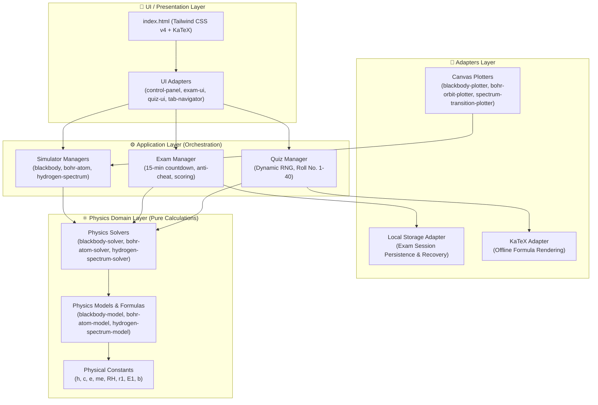

# ⚛️ Interactive Physics Learning Portal
### รายวิชา ฟิสิกส์ 6 (ว33206) | บทที่ 19 ฟิสิกส์อะตอม (19.1 สมมติฐานของพลังค์และทฤษฎีอะตอมของโบร์)

[](#)
[](.agents/skills/physics-learning-standard/SKILL.md)
[](#-10-สิทธิ์การใช้งาน-license)
[](#)
[](#-9-การทดสอบและการตรวจสอบความถูกต้อง-validation--testing)

---

> [!NOTE]
> 🏛️ **Architecture Reference Implementation (Physics Learning Standard v1.13.0)**
> เว็บแอปพลิเคชันการเรียนรู้ฟิสิกส์เชิงโต้ตอบสำหรับ **บทที่ 19 ฟิสิกส์อะตอม (หัวข้อย่อย 19.1.1 การแผ่คลื่นแม่เหล็กไฟฟ้าของวัตถุดำ และ 19.1.2 ทฤษฎีอะตอมของโบร์)** พัฒนาตามสถาปัตยกรรม Clean Architecture / Domain-Centric Design โดยมี 3 Navigation Cards, 3 Interactive Simulators, Dynamic Quiz RNG ตามเลขที่นักเรียน และระบบสอบจับเวลา 15 นาที พร้อม Anti-Cheat และ Session Recovery 100%

---

## 📌 สารบัญ (Table of Contents)

- [1. ข้อมูลและอัตลักษณ์ของโครงการ (Project Identity)](#1-ข้อมูลและอัตลักษณ์ของโครงการ-project-identity)
- [2. สรุปภาพรวมโครงการ (Project Summary & Overview)](#2-สรุปภาพรวมโครงการ-project-summary--overview)
- [3. วัตถุประสงค์และผลการเรียนรู้ (Learning Objectives)](#3-วัตถุประสงค์และผลการเรียนรู้-learning-objectives)
- [4. ขอบเขตเนื้อหาและสูตรสำคัญ (Physics Scope & Key Formulas)](#4-ขอบเขตเนื้อหาและสูตรสำคัญ-physics-scope--key-formulas)
- [5. ฟีเจอร์การเรียนรู้ (Learning Features & Simulators)](#5-ฟีเจอร์การเรียนรู้-learning-features--simulators)
  - [5.1 เครื่องมือจำลองเสมือนจริง 3 ตัว (Interactive Simulators)](#51-เครื่องมือจำลองเสมือนจริง-3-ตัว-interactive-simulators)
  - [5.2 ระบบฝึกทำโจทย์ไดนามิก (Dynamic Quiz Engine)](#52-ระบบฝึกทำโจทย์ไดนามิก-dynamic-quiz-engine)
  - [5.3 ระบบสอบจับเวลาและป้องกันการทุจริต (Timed Exam & Anti-Cheat)](#53-ระบบสอบจับเวลาและป้องกันการทุจริต-timed-exam--anti-cheat)
- [6. สถาปัตยกรรมระบบ (System Architecture)](#6-สถาปัตยกรรมระบบ-system-architecture)
- [7. โครงสร้างโปรเจกต์ (Project Structure)](#7-โครงสร้างโปรเจกต์-project-structure)
- [8. การติดตั้งและการใช้งาน (Installation & Quick Start)](#8-การติดตั้งและการใช้งาน-installation--quick-start)
- [9. การทดสอบและการตรวจสอบความถูกต้อง (Validation & Testing)](#9-การทดสอบและการตรวจสอบความถูกต้อง-validation--testing)
- [10. สิทธิ์การใช้งาน (License)](#10-สิทธิ์การใช้งาน-license)

---

# 1. ข้อมูลและอัตลักษณ์ของโครงการ (Project Identity)

| ข้อมูลหลัก (Field) | รายละเอียด (Value) |
| :--- | :--- |
| Repository profile | `learning-unit` |
| Standard version | `1.13.0` |
| Compliance status | `Compliant` |
| Standard reference | [physics-learning-standard](.agents/skills/physics-learning-standard/SKILL.md) |
| Maintainer | Nopphorn Somboonchai |
| Target learners | นักเรียนระดับชั้นมัธยมศึกษาปีที่ 6 (Grade 12) |
| Course | ว33206 ฟิสิกส์ 6 (หลักสูตรแกนกลางการศึกษาขั้นพื้นฐาน สสวท.) |
| Unit | บทที่ 19 ฟิสิกส์อะตอม (Atomic Physics) |
| Main topic | 19.1 สมมติฐานของพลังค์และทฤษฎีอะตอมของโบร์ |
| Primary UI language | ภาษาไทย (คำศัพท์เฉพาะและสัญลักษณ์ทางฟิสิกส์มาตรฐานสากล) |
| Learner data handling | Local only (LocalStorage Client-side) |

---

# 2. สรุปภาพรวมโครงการ (Project Summary & Overview)

**Interactive Physics Learning Portal (Unit 19.1)** เป็นระบบสื่อการเรียนรู้ฟิสิกส์ดิจิทัลแบบโต้ตอบสำหรับนักเรียนระดับชั้น ม.6 ออกแบบและพัฒนาขึ้นภายใต้มาตรฐานวิศวกรรมซอฟต์แวร์การศึกษา **Physics Learning Standard (v1.13.0)**

### 🌟 จุดเด่นสำคัญของระบบ:
1. **Interactive Simulation Driven**: เชื่อมโยงมโนทัศน์นามธรรม (เช่น การสั่นควอนตัม, วงโคจรโบร์, การเปลี่ยนระดับพลังงานโฟตอน) ให้เห็นภาพจริงแบบ Real-time ด้วย Canvas 2D เรนเดอร์
2. **Deterministic Seeded RNG Quiz Engine**: สร้างแบบฝึกหัดคำนวณเฉพาะบุคคลตาม **เลขที่นักเรียน (1–40)** ช่วยป้องกันการลอกคำตอบ และส่งเสริมการเรียนรู้รายบุคคล
3. **Timed Exam with Anti-Cheat**: ห้องสอบจับเวลาจริง 15 นาที พร้อมระบบตรวจจับการสลับแท็บ/หน้าต่าง (Tab Switch Detection) และระบบกู้คืนเซสชันเมื่อรีเฟรชหน้าเว็บ (Session Interruption Recovery)
4. **Clean Architecture Separation**: แยก Physics Domain Logic บริสุทธิ์ออกจาก Browser DOM, Canvas และ LocalStorage ทำให้ทดสอบ Unit Test ครอบคลุมได้ 100%

---

# 3. วัตถุประสงค์และผลการเรียนรู้ (Learning Objectives)

เมื่อเสร็จสิ้นกิจกรรมการเรียนรู้ผ่านพอร์ทัลนี้ ผู้เรียนสามารถ:

1. **อธิบายสมมติฐานของพลังค์ (Explain Planck's Hypothesis)**: อธิบายการแผ่รังสีของวัตถุดำ, ปรากฏการณ์หายนะอัลตราไวโอเลต (Ultraviolet Catastrophe) ของฟิสิกส์ดั้งเดิม และแนวคิดควอนตัมของพลังงานได้ถูกต้อง
2. **อธิบายแบบจำลองอะตอมของโบร์ (Explain Bohr's Atomic Model)**: สรุปสมมติฐาน 2 ข้อของโบร์, สภาวะคงตัวของวงโคจรอิเล็กตรอน, และกลไกการปล่อย/ดูดกลืนโฟตอนได้ถูกต้อง
3. **คำนวณปริมาณฟิสิกส์อะตอม (Calculate Physical Quantities)**:
   - พลังงานของควอนตัมและโฟตอนเดี่ยวจากความถี่และความยาวคลื่น
   - ความยาวคลื่นสูงสุดตามกฎการกระจัดของวีน
   - รัศมีวงโคจร, อัตราเร็ว, โมเมนตัมเชิงมุม, และระดับพลังงานของอิเล็กตรอนในอะตอมไฮโดรเจน
   - ความยาวคลื่นและสเปกตรัมที่ปล่อยออกมาตามสูตรของริดเบิร์ก
4. **วิเคราะห์ความสัมพันธ์เชิงกราฟและสเปกตรัม (Analyze Graphs & Spectra)**: เปรียบเทียบความสัมพันธ์ระหว่างอุณหภูมิกับการแผ่รังสี และระบุอนุกรมสเปกตรัมของไฮโดรเจน (Lyman, Balmer, Paschen, Brackett, Pfund) ได้อย่างแม่นยำ

---

# 4. ขอบเขตเนื้อหาและสูตรสำคัญ (Physics Scope & Key Formulas)

เนื้อหาครอบคลุมตามหลักสูตร สสวท. ฟิสิกส์ ม.6 เล่ม 6 บทที่ 19 หัวข้อย่อย 19.1 โดยใช้ค่าคงที่สากลตามมาตรฐาน CODATA:

### 4.1 การแผ่รังสีของวัตถุดำและสมมติฐานของพลังค์ (Blackbody Radiation)
- **พลังงานควอนตัมของพลังค์ (Planck's Quantum Energy)**:
  $$E = nhf = nh\frac{c}{\lambda} \quad (n = 1, 2, 3, \dots)$$
- **พลังงานของโฟตอน 1 อนุภาค (Single Photon Energy)**:
  $$E = hf = \frac{hc}{\lambda}$$
- **กฎการกระจัดของวีน (Wien's Displacement Law)**:
  $$\lambda_{\max} T = b = 2.898 \times 10^{-3} \text{ m}\cdot\text{K}$$

### 4.2 แบบจำลองอะตอมของโบร์ (Bohr's Atomic Model)
- **สมมติฐานข้อที่ 1: วงโคจรคงตัวและโมเมนตัมเชิงมุม (Stationary Orbits & Angular Momentum)**:
  $$L = m_e v_n r_n = n\hbar = n\frac{h}{2\pi} \quad (n = 1, 2, 3, \dots)$$
- **รัศมีวงโคจรของโบร์ (Bohr Radius)**:
  $$r_n = n^2 r_1 \quad (r_1 = 0.529 \text{ \AA} = 5.29 \times 10^{-11} \text{ m})$$
- **อัตราเร็วของอิเล็กตรอนในวงโคจร (Orbital Speed)**:
  $$v_n = \frac{v_1}{n} \quad (v_1 = 2.18 \times 10^6 \text{ m/s})$$
- **ระดับพลังงานของอิเล็กตรอนในอะตอมไฮโดรเจน (Hydrogen Energy Levels)**:
  $$E_n = -\frac{13.6}{n^2} \text{ eV} = -\frac{2.18 \times 10^{-18}}{n^2} \text{ J}$$
- **สมมติฐานข้อที่ 2: การเปลี่ยนระดับพลังงาน (Energy Transitions & Photons)**:
  $$\Delta E = |E_i - E_f| = hf = \frac{hc}{\lambda}$$
- **สูตรของริดเบิร์กสำหรับสเปกตรัมไฮโดรเจน (Rydberg Formula)**:
  $$\frac{1}{\lambda} = R_H \left(\frac{1}{n_f^2} - \frac{1}{n_i^2}\right) \quad (R_H = 1.097 \times 10^7 \text{ m}^{-1})$$

### 4.3 อนุกรมเส้นสเปกตรัมของไฮโดรเจน (Hydrogen Spectral Series)
| อนุกรม (Series) | ระดับปลายทาง ($n_f$) | ระดับเริ่มต้น ($n_i$) | ย่านคลื่นแม่เหล็กไฟฟ้า (EM Region) |
| :--- | :---: | :---: | :--- |
| **Lyman (ไลแมน)** | $n_f = 1$ | $n_i = 2, 3, 4, \dots$ | อัลตราไวโอเลต (Ultraviolet: UV) |
| **Balmer (บัลเมอร์)** | $n_f = 2$ | $n_i = 3, 4, 5, \dots$ | แสงที่ตามองเห็น (Visible) & UV ใกล้ |
| **Paschen (พาสเชน)** | $n_f = 3$ | $n_i = 4, 5, 6, \dots$ | อินฟราเรดใกล้ (Near Infrared: IR) |
| **Brackett (แบรักเกต)** | $n_f = 4$ | $n_i = 5, 6, 7, \dots$ | อินฟราเรด (Infrared: IR) |
| **Pfund (ฟุนด์)** | $n_f = 5$ | $n_i = 6, 7, 8, \dots$ | อินฟราเรดไกล (Far Infrared: IR) |

> [!TIP]
> **เส้นเด่นในอนุกรมบัลเมอร์ที่ตามองเห็นได้**:
> - $H_\alpha$ ($n = 3 \to 2$): $\lambda = 656.3 \text{ nm}$ (สีแดงสด)
> - $H_\beta$ ($n = 4 \to 2$): $\lambda = 486.1 \text{ nm}$ (สีฟ้าแกมเขียว / Cyan)
> - $H_\gamma$ ($n = 5 \to 2$): $\lambda = 434.0 \text{ nm}$ (สีน้ำเงิน)
> - $H_\delta$ ($n = 6 \to 2$): $\lambda = 410.2 \text{ nm}$ (สีม่วง)

---

# 5. ฟีเจอร์การเรียนรู้ (Learning Features & Simulators)

## 5.1 เครื่องมือจำลองเสมือนจริง 3 ตัว (Interactive Simulators)

```
┌──────────────────────────────────────────────────────────────────────────┐
│ 🔬 TAB 1: INTERACTIVE SIMULATORS                                         │
│ ┌─────────────────────┐ ┌─────────────────────┐ ┌──────────────────────┐ │
│ │ 19.1.1 Blackbody    │ │ 19.1.2A Bohr Orbits │ │ 19.1.2B Spectra      │ │
│ │ Planck vs Rayleigh  │ │ n=1..5 Scale Radius │ │ Photon Jump & Colors │ │
│ └─────────────────────┘ └─────────────────────┘ └──────────────────────┘ │
└──────────────────────────────────────────────────────────────────────────┘
```

1. **Simulator 1 (19.1.1): Blackbody Radiation & Planck Distribution**
   - แถบปรับอุณหภูมิผิวสัมผัส ($T = 1,500\text{ K}$ ถึง $9,500\text{ K}$)
   - สลับดูกราฟทฤษฎีดั้งเดิมของเรย์ลีห์-จีนส์ ($I \propto \lambda^{-4}$) เพื่อสัมผัสปรากฏการณ์หายนะอัลตราไวโอเลต เทียบกับเส้นโค้งควอนตัมของพลังค์
   - คำนวณและพล็อตจุดยอดความยาวคลื่น $\lambda_{\max}$ ตามกฎของวีนแบบพลวัต
   - แถบไฮไลต์ย่านแสงที่ตามองเห็น (Visible Spectrum 380–750 nm) แสดงสีสเปกตรัมจริง

2. **Simulator 2 (19.1.2A): Bohr Atomic Orbits & Dynamics**
   - ปรับเลือกระดับชั้นพลังงาน ($n = 1, 2, 3, 4, 5$)
   - แสดงนิวเคลียสใจกลางและวงโคจรสเกลสัมพัทธ์จริงตาม $r_n = n^2 r_1$
   - แอนิเมชันอิเล็กตรอนเคลื่อนที่เป็นวงกลมด้วยอัตราเร็วเชิงมุมสมจริงตาม $v_n = v_1 / n$
   - แสดงเวกเตอร์ความเร็วสัมผัสวงโคจร ($\vec{v}_n$) พร้อมป้ายข้อมูล $E_n$, $r_n$, $v_n$ และโมเมนตัมเชิงมุม $L = n\hbar$

3. **Simulator 3 (19.1.2B): Hydrogen Energy Transitions & Spectra**
   - แผงเลือกระดับชั้นพลังงานเริ่มต้น $n_i$ และระดับสิ้นสุด $n_f$
   - แอนิเมชันจำลองอิเล็กตรอนเปลี่ยนระดับชั้น พร้อมปล่อยคลื่นโฟตอนเป็นแสงสีจริงที่ตรงกับความยาวคลื่นที่คำนวณได้
   - ไดอะแกรมบันไดระดับพลังงาน ($E_1 = -13.6\text{ eV}$ จนถึง $E_\infty = 0\text{ eV}$)
   - แถบสเปกตรัมส่องสว่าง พร้อมปุ่มลัดเลือกเส้นเด่นอนุกรมบัลเมอร์ ($H_\alpha, H_\beta, H_\gamma$)

---

## 5.2 ระบบฝึกทำโจทย์ไดนามิก (Dynamic Quiz Engine)

```
┌──────────────────────────────────────────────────────────────────────────┐
│ 🎲 TAB 2: DYNAMIC RNG PRACTICE                                           │
│ ┌──────────────────────┐ ┌──────────────────────┐ ┌────────────────────┐ │
│ │ 19.1.1 วัตถุดำ & วีน  │ │ 19.1.2 แบบจำลองโบร์  │ │ 19.1.3 สเปกตรัม   │ │
│ │ สุ่มเลขที่ 1 - 40     │ │ สุ่มเลขที่ 1 - 40     │ │ สุ่มเลขที่ 1 - 40   │ │
│ └──────────────────────┘ └──────────────────────┘ └────────────────────┘ │
└──────────────────────────────────────────────────────────────────────────┘
```

- **Seeded RNG ตามเลขที่นักเรียน (1–40)**: แต่ละเลขที่จะได้รับตัวเลขโจทย์และบริบทแตกต่างกันอย่างเป็นเอกลักษณ์
- **โหมดสลับมาตรฐาน / ไดนามิก**: สามารถเลือกฝึกทำโจทย์แบบสแตนดาร์ดหรือโหมดสุ่มตัวเลขรายบุคคล
- **ระบบตรวจคำตอบอัจฉริยะ (Smart Numeric Grading)**: รองรับความคลาดเคลื่อนทางคณิตศาสตร์ **$\pm 3\%$**
- **เฉลยวิธีทำทีละขั้นตอน (Step-by-Step KaTeX Solution)**: แสดงสูตร การแทนค่า และคำตอบอย่างละเอียดพร้อมหน่วย

---

## 5.3 ระบบสอบจับเวลาและป้องกันการทุจริต (Timed Exam & Anti-Cheat)

```
┌──────────────────────────────────────────────────────────────────────────┐
│ ⏱️ TAB 3: TIMED ASSESSMENT                                              │
│ [ ⏱️ 14:59 ] [ ⚠️ สลับหน้าจอ: 0 ครั้ง ] [ ข้อที่ 1/5 ] [ บันทึกสถานะ Auto ] │
└──────────────────────────────────────────────────────────────────────────┘
```

- **นาฬิกาจับเวลาถอยหลัง 15:00 นาที**: แสดงสถานะเรียลไทม์ และกระพริบเตือนสีแดงเมื่อเหลือเวลาต่ำกว่า 3 นาที
- **ข้อสอบมาตรฐาน 5 ข้อ (10 คะแนนเต็ม)**:
  - ข้อที่ 1: ข้อสอบปรนัย 4 ตัวเลือก (สุ่มสลับช้อยส์ตาม Attempt Seed)
  - ข้อที่ 2–5: ข้อสอบคำนวณตัวเลขเติมคำ ครอบคลุมทั้งสองหัวข้อย่อย
- **ระบบตรวจจับการทุจริต (Anti-Cheat Monitor)**: ดักจับและบันทึกจำนวนครั้งที่นักเรียนสลับแท็บเบราว์เซอร์หรือย่อหน้าต่าง พร้อมแสดง Toast Notification เตือนสีแดงสั่น
- **ระบบกู้คืนเซสชัน (Interruption Session Recovery)**: บันทึกความคืบหน้าลง `localStorage` เสมอ เมื่อเกิดเหตุไฟดับหรือรีเฟรชเบราว์เซอร์ สามารถกลับมาทำข้อสอบต่อจากวินาทีที่เหลืออยู่ได้ทันที
- **สรุปรายงานผลสอบและการประเมิน**: แสดงระดับผลการเรียนรู้ พร้อมปุ่มพิมพ์เกียรติบัตร / รายงานสรุปคะแนน

---

# 6. สถาปัตยกรรมระบบ (System Architecture)

ตามข้อกำหนดของ **Physics Learning Standard (v1.13.0)** สถาปัตยกรรมใช้หลักการ **Domain-Centric Architecture (Clean Architecture)** โดยทิศทางของ Dependency จะชี้เข้าสู่ Physics Domain เสมอ:



### รายละเอียดการแยกเลเยอร์ (Separation of Concerns):
- **Physics Domain (`src/physics/`)**: ปราศจาก DOM, Canvas, Window, LocalStorage, หรือ KaTeX คำนวณค่าตัวเลขทางฟิสิกส์ล้วน (Pure Domain Functions)
- **Application Layer (`src/application/`)**: ควบคุม State Machine ของการสอบ, จัดการ Animation Loop ของแบบจำลอง, จัดการ Seed สุ่มโจทย์
- **Adapters Layer (`src/adapters/`)**: วาดภาพลง Canvas 2D เรนเดอร์ความละเอียดสูง, จัดเก็บข้อมูลใน LocalStorage, เรนเดอร์สูตร KaTeX
- **Shared & Utilities (`src/shared/`, `src/utils/`)**: จัดเก็บค่าคงที่สากล, ตรวจสอบความคลาดเคลื่อน $\pm 3\%$, และ Fisher-Yates RNG Shuffle

---

# 7. โครงสร้างโปรเจกต์ (Project Structure)

```text
Unit-19-Physics Atom-19.1/
├── .agents/skills/                         # เอกสารและมาตรฐาน Physics Learning Standard v1.13.0
├── assets/styles/
│   ├── animations.css                      # คีย์เฟรมเรืองแสง, Glow Effects, Orbital Spin
│   ├── main.css                            # Tailwind CSS v4 Theme Design Tokens
│   └── style.css                           # สไตล์ชีตรวมหลังคอมไพล์
├── dist/
│   └── bundle.js                           # Production JavaScript Bundle (esbuild)
├── src/
│   ├── adapters/                           # เลเยอร์เชื่อมต่อภายนอก (Adapters)
│   │   ├── canvas/
│   │   │   ├── blackbody-plotter.js        # วาดกราฟการแผ่รังสีวัตถุดำ & กราฟเรย์ลีห์-จีนส์
│   │   │   ├── bohr-orbit-plotter.js       # วาดวงโคจรอิเล็กตรอน & เวกเตอร์ความเร็ว
│   │   │   ├── canvas-renderer.js          # Base Canvas High-DPI Engine
│   │   │   └── spectrum-transition-plotter.js # วาดไดอะแกรมระดับพลังงาน & โฟตอนสีจริง
│   │   ├── formula/
│   │   │   └── katex-adapter.js            # อะแดปเตอร์เชื่อมต่อ Offline KaTeX
│   │   ├── storage/
│   │   │   └── local-storage.js            # จัดเก็บสถานะข้อสอบและคะแนนใน LocalStorage
│   │   └── ui/
│   │       ├── control-panel.js            # ผูก UI Controls กับ Simulators
│   │       ├── exam-ui.js                  # ควบคุมหน้าจอสอบ, นาฬิกา, Anti-cheat & Toast
│   │       ├── quiz-ui.js                  # ควบคุมหน้าจอควิซฝึกฝน 3 การ์ดหัวข้อ
│   │       ├── simulator-loader.js         # Calibrator Progress Loader ก่อนเปิดซิม
│   │       └── tab-navigator.js            # ควบคุมแท็บเมนูหลักและเมนูย่อย
│   ├── application/                        # เลเยอร์จัดการตรรกะระบบ (Application)
│   │   ├── blackbody-simulator.js          # Orchestrator แบบจำลองวัตถุดำ 19.1.1
│   │   ├── bohr-atom-simulator.js          # Orchestrator แบบจำลองวงโคจรโบร์ 19.1.2A
│   │   ├── exam-manager.js                 # State Machine ข้อสอบ 15 นาที พร้อมกู้คืนเซสชัน
│   │   ├── hydrogen-spectrum-simulator.js  # Orchestrator แบบจำลองสเปกตรัมไฮโดรเจน 19.1.2B
│   │   └── quiz-manager.js                 # ตัวสร้างโจทย์สุ่ม RNG ตามเลขที่ 1-40
│   ├── physics/                            # โดเมนฟิสิกส์บริสุทธิ์ (Pure Physics Domain)
│   │   ├── blackbody-model.js              # โมเดลคณิตศาสตร์ Planck & Wien
│   │   ├── blackbody-solver.js             # คำนวณพลังงานควอนตัม & วัตถุดำ
│   │   ├── bohr-atom-model.js              # โมเดลคณิตศาสตร์วงโคจรอะตอมโบร์
│   │   ├── bohr-atom-solver.js             # คำนวณ rn, vn, En, โมเมนตัมเชิงมุม L
│   │   ├── hydrogen-spectrum-model.js      # ชุดอนุกรมสเปกตรัม & เส้นเด่นบัลเมอร์
│   │   └── hydrogen-spectrum-solver.js     # คำนวณสูตรริดเบิร์ก & แปลงความยาวคลื่นเป็นสี RGB
│   ├── shared/                             # ค่าคงที่และการตั้งค่าส่วนกลาง
│   │   ├── config.js                       # ข้อมูลการตั้งค่าระบบและเวอร์ชัน
│   │   └── constants.js                    # ค่าคงที่สากล (h, c, e, me, RH, r1, E1, b)
│   ├── utils/                              # เครื่องมือช่วยเหลือทั่วไป
│   │   ├── format.js                       # จัดรูปแบบตัวเลขและสัญกรณ์วิทยาศาสตร์
│   │   ├── random.js                       # Seeded RNG & Fisher-Yates Shuffle
│   │   └── validation.js                   # ตรวจสอบคำตอบตัวเลขพร้อมความคลาดเคลื่อน ±3%
│   └── main.js                             # จุดเริ่มต้นแอปพลิเคชัน (Application Entry Point)
├── tests/                                  # ชุดการทดสอบอัตโนมัติ (Automated Tests)
│   ├── exam.test.js                        # ทดสอบระบบสอบจับเวลาและ State Machine
│   ├── integration.test.js                 # ทดสอบการบูรณาการระบบครบวงจร
│   ├── physics.test.js                     # ทดสอบความถูกต้องของโมเดลฟิสิกส์
│   ├── quiz.test.js                        # ทดสอบระบบควิซ RNG และความคลาดเคลื่อน 3%
│   ├── simulator-loader.test.js            # ทดสอบ Calibrator Loader
│   └── viewport-geometry.test.js           # ทดสอบความเข้ากันได้ทุกขนาดหน้าจอ (360px - 1440px)
├── vendor/katex/                           # คลังไลบรารี KaTeX แบบออฟไลน์ (No CDN Needed)
├── index.html                              # หน้าเว็บหลักของแอปพลิเคชัน
└── package.json                            # การตั้งค่า Dependencies และคำสั่งสคริปต์
```

---

# 8. การติดตั้งและการใช้งาน (Installation & Quick Start)

### ความต้องการของระบบ (Prerequisites):
- [Node.js](https://nodejs.org/) เวอร์ชัน 18.0.0 หรือใหม่กว่า
- เว็บเบราว์เซอร์สมัยใหม่ (Chrome, Edge, Firefox, Safari) ที่รองรับ ES2025 Modules

### ขั้นตอนการติดตั้ง:
```bash
# 1. โคลนคลังโค้ด
git clone https://github.com/Nopphorn-Somboonchai/Unit-19-Physics-Atom-19.1.git

# 2. เข้าสู่โฟลเดอร์โปรเจกต์
cd "Unit-19-Physics Atom-19.1"

# 3. ติดตั้งแพ็กเกจที่จำเป็น
npm install
```

### คำสั่งพัฒนาและทดสอบ (Available Scripts):
```bash
# รันชุดแบบทดสอบทั้งหมด (Physics, Quiz, Exam, Integration, Viewport, Loader)
npm test

# คอมไพล์ CSS ด้วย Tailwind v4 และ Bundled JavaScript ด้วย esbuild
npm run build

# รันคอมไพเลอร์ในโหมด Watch ขณะแก้ไขโค้ด
npm run dev

# รันเว็บเซิร์ฟเวอร์จำลองบนเครื่องคอมพิวเตอร์ (Local Server)
npm run serve
```

---

# 9. การทดสอบและการตรวจสอบความถูกต้อง (Validation & Testing)

โปรเจกต์ผ่านการทดสอบครอบคลุมทั้ง 6 Test Suites รวมมากกว่า 100 ข้อความตรวจสอบ ด้วยผลลัพธ์ **100% Passed (0 Failures)**:

```bash
npm test
```

### สรุปผลการตรวจสอบแต่ละด้าน:
1. **Physics Accuracy Audit (`tests/physics.test.js`)**: ตรวจสอบค่าคำนวณ $E, \lambda_{\max}, r_n, v_n, E_n, L$ เทียบกับค่ามาตรฐาน CODATA และทฤษฎี สสวท. (39 ข้อสอบผ่าน)
2. **Dynamic RNG Quiz Audit (`tests/quiz.test.js`)**: ตรวจสอบการจำกัดเลขที่ 1–40, การสุ่มแบบ Deterministic Seed, และเกณฑ์ความคลาดเคลื่อน $\pm 3\%$ (18 ข้อสอบผ่าน)
3. **Timed Exam State Machine (`tests/exam.test.js`)**: ตรวจสอบการนับถอยหลัง 15 นาที, การคำนวณคะแนน 10 คะแนน, การดักจับ Anti-Cheat, และการกู้คืนเซสชันเมื่อรีเฟรชหน้าเว็บ (26 ข้อสอบผ่าน)
4. **Master Integration Suite (`tests/integration.test.js`)**: ตรวจสอบการไหลของข้อมูลข้ามเลเยอร์ตาม Clean Architecture (22 ข้อสอบผ่าน)
5. **Multi-Viewport Geometry Clearance (`tests/viewport-geometry.test.js`)**: ตรวจสอบการเรนเดอร์ Canvas ไม่ล้นจอ และป้ายสเกลอ่านออกชัดเจนบนหน้าจอ Mobile Compact (360px), Mobile Standard (393px), iPad Portrait (768px), iPad Landscape (1024px), และ Desktop (1440px)
6. **Simulator Loader Audit (`tests/simulator-loader.test.js`)**: ตรวจสอบ State การสอบเทียบ Progress Loader และการป้องกันการโหลดซ้ำ

---

# 10. สิทธิ์การใช้งาน (License)

โครงการนี้เผยแพร่ภายใต้สัญญาอนุญาตสิทธิ์ [MIT License](LICENSE) สามารถนำไปใช้เพื่อประโยชน์ทางการศึกษา พัฒนาต่อยอด และเผยแพร่ได้อย่างเสรี
